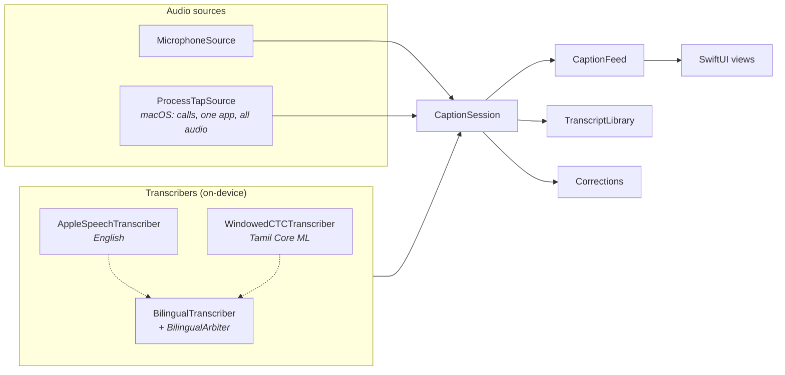

# Saptham

**Private, on-device live captions for people who are deaf or hard of hearing — on Mac and iPhone, in English, Tamil, and the Tamil–English mix of everyday conversation.**

[](LICENSE)


Saptham (சப்தம், *"sound"*) turns speech into text as it is spoken: phone and FaceTime calls, meetings, videos, and the people in the room. It also tells you about sounds you might miss, such as the doorbell, a smoke alarm or someone calling your name.

All recognition runs on your device. Saptham sends no audio, transcript or analytics anywhere, has no account, and uses no cloud speech or language service.

---

## Contents

- [Why Saptham](#why-saptham)
- [Features](#features)
- [Privacy by design](#privacy-by-design)
- [Requirements](#requirements)
- [Getting started](#getting-started)
- [Building the Tamil speech model](#building-the-tamil-speech-model)
- [Sign-language packs](#sign-language-packs)
- [Running the tests](#running-the-tests)
- [Architecture](#architecture)
- [Repository layout](#repository-layout)
- [Permissions](#permissions)
- [Diagnostics](#diagnostics)
- [Known limitations](#known-limitations)
- [Roadmap](#roadmap)
- [Contributing](#contributing)
- [Security](#security)
- [License](#license)
- [Acknowledgements](#acknowledgements)

---

## Why Saptham

Most captioning tools are built for English and send your audio to a server. That leaves out two groups of people:

- **People who speak Tamil, or switch between Tamil and English mid-sentence.** That mixing is how much of South India talks. Single-language recognisers either mangle the English words or drop the Tamil ones.
- **People who don't want their conversations to leave their device.** That covers calls with a doctor or a bank, and family conversations.

Saptham is built for both. It runs a Tamil speech model and Apple's English recogniser side by side and chooses, stretch by stretch, whichever is more confident. Everything runs locally on the device.

## Features

### On Mac

| Area | What it does |
| --- | --- |
| **Call captions** | Captions iPhone calls relayed to the Mac and FaceTime calls. Saptham stays armed in the background: when call audio starts, the caption window appears, and it hides itself again 30 seconds after the call ends. |
| **Everything playing** | Captions any app's audio — meetings, videos, browsers — through a Core Audio process tap. The sound keeps playing normally; Saptham only listens. |
| **Conversation** | Captions people talking near the Mac through the microphone, including an iPhone used as a Continuity microphone. |
| **Floating caption window** | A non-activating glass panel that floats above other windows without taking focus. It falls back to a solid window when Reduce Transparency or Increase Contrast is on. |
| **Transcripts** | Saves settled lines by day (Today / Yesterday / Earlier). You can edit single words, whole lines or the whole transcript, and replay the audio behind any line if recording is on. Transcripts are kept for 1, 7, 30, 90 or 365 days, or forever. |
| **Voice notes** | Transcribes saved audio files, such as voice messages from a chat app, with the same recognisers used for live captions. |
| **Corrections** | Lets you teach Saptham words it gets wrong ("when you hear *X*, show *Y*"). When you fix the same thing by hand several times, Saptham offers it as a rule. Nothing is learnt until you accept it. |
| **Sound alerts** | Shows a glowing frame and a large card on every screen, including over full-screen apps, plus a notification that stays in Notification Center. The frame pulses below the seizure threshold, never pulses with Reduce Motion on, and lets clicks through. |
| **Name alerts** | Listens for your name in every caption mode, and even when captions are off. It understands Tamil case endings (சுரேஷ் → சுரேஷை, சுரேஷுக்கு). |
| **Sign dictionary** *(opt-in)* | In a saved transcript, select a word and choose **Show sign** to see a recorded Deaf signer's dictionary sign for it. On the Mac, packs come only from the Debug "Import pack from Files" option (see [Known limitations](#known-limitations)). |
| **Capture health** | Warns when audio is arriving broken up or as pure digital silence, for example when the microphone is blocked or Safari is playing to Bluetooth hearing devices, instead of leaving the caption window silently empty. |

### On iPhone

| Area | What it does |
| --- | --- |
| **Reading band** | Live captions in a large reading band built from light, line and type rather than buttons. The newest sentence sits large in the band, and each sentence that settles rises onto a "thread" above it. |
| **Posture control** | Raise the phone to read. Lay it flat to share with the person opposite: the screen splits and their half turns to face them, so they can see what Saptham understood. Turn it face down to stop captions (sound alerts stay on). |
| **Live Activity** | Captions on the Lock Screen and in the Dynamic Island, updated at most once a second. |
| **Sound and name alerts** | Pulses the screen edges with a strong vibration while the app is open, and sends a notification when it isn't. |
| **Conversation assistant** | Ask questions about a saved conversation, or get a three-point summary, using **only** Apple's on-device language model (never Private Cloud Compute). Offered only when Apple Intelligence is available and supports the conversation's language. |
| **Battery meter** | Measures what each captioning session actually cost in battery, for sessions of 10 minutes or more. |
| **Sound direction** *(experimental)* | Estimates which side a voice comes from, using the stereo microphone. |
| **Sign dictionary** *(opt-in)* | In a saved transcript, tap a word to see a recorded Deaf signer's dictionary sign for it: a silent looping clip with 0.5× speed, replay and credits, or a clear "no sign" answer. Signs are for single words only; Saptham never signs whole sentences. It's off until you turn it on in Settings → Sign language, where packs are downloaded, updated and deleted. |

### Shared engine

- **Three caption languages:** Tamil + English (the default), Tamil, and English (India). Each language is shown in its own script in the picker.
- **Bilingual arbitration.** Both recognisers hear the same audio. Tamil script is shown by default, and English replaces it wherever Apple's English recogniser is confident it heard English.
- **Silence gating.** A cheap loudness gate with a learned background level skips silence, so the speech models don't spend battery on hours of quiet rooms or fan noise.
- **Music notice.** Apple's sound classifier detects music and singing. Instead of captioning a song badly, Saptham says that music is playing, with hysteresis so the notice doesn't flicker on drum fills.
- **Speech tone.** The caption's type weight reflects how loudly a sentence was said. You get the words, and some of the voice.
- **Sound alerts for 11 everyday sounds:** doorbell, knocking, smoke or fire alarm, alarm clock, whistle (pressure cooker or kettle), baby crying, someone shouting, phone ringing, dog barking, siren, glass breaking.

## Privacy by design

Privacy is a constraint the code is built around, not a setting you can switch off.

- **On-device speech only.** English uses Apple's on-device `SpeechAnalyzer` recognisers. Tamil uses a Core ML model bundled into the app and run on the device's CPU and GPU.
- **On-device language model only.** The iPhone conversation assistant uses `SystemLanguageModel`. It never uses Private Cloud Compute.
- **No analytics, accounts or servers.** The apps contain no analytics, telemetry, crash reporting or accounts, and Saptham runs no server.
- **One optional download, served by Apple.** The only network request is fetching a sign-language pack, and only when you tap Download in Settings → Sign language. Apple's asset-pack hosting serves it. The request names the pack, never a word you looked up or anything from your captions, and the signs then work offline.
- **Logs never contain speech.** The diagnostics channel records timings and states, never caption text or audio content.
- **Recording is opt-in.** Call recording is off by default. Recordings and transcripts stay in the app's container and expire after the retention period you choose.
- **No third-party SDKs.** The engine uses Apple frameworks only. The one bundled third-party component is the MIT-licensed Tamil speech model (see [Acknowledgements](#acknowledgements)).

## Requirements

| | Minimum |
| --- | --- |
| Mac | macOS 27 |
| iPhone | iOS 27 |
| Xcode | 27.1 (Swift 6 toolchain) |
| Project generator | [XcodeGen](https://github.com/yonaskolb/XcodeGen) 2.46 or later |
| Tamil model build *(optional)* | Python 3.12 and about 5 GB of free disk space for the checkpoint and toolchain *(estimate)* |
| Conversation assistant *(optional)* | An iPhone with Apple Intelligence turned on |

Saptham needs macOS 27 and iOS 27 because it uses the current `SpeechAnalyzer` API, Core Audio process taps and Liquid Glass.

## Getting started

### 1. Clone and generate the Xcode project

The Xcode project is generated from [`project.yml`](project.yml) and isn't committed.

```bash
git clone https://github.com/Nerttiyana-Technologies/saptham.git
cd saptham
brew install xcodegen
xcodegen generate
open Saptham.xcodeproj
```

Run `xcodegen generate` again whenever you add or remove files, or change `project.yml`.

### 2. Set up code signing

`project.yml` is configured for the maintainers' Apple Developer team. To build on your own machine:

1. In Xcode, select each target (**SapthamMac**, **SapthamPhone**, **SapthamLiveActivity**, **SapthamSignDownloader**) and, under **Signing & Capabilities**, choose your own team.
2. The Mac target uses manual signing with a **Developer ID Application** certificate. A stable identity means macOS keeps your microphone and audio-capture permissions across rebuilds. If you don't have a Developer ID, switch the Mac target to **Automatic** signing with an **Apple Development** certificate. Expect macOS to ask for permissions again after some rebuilds.
3. If you build an iOS target on a free account, change the bundle identifier prefix (`com.nerttiyana.saptham`) to one of your own.
4. The iPhone app and its sign-pack downloader share the app group `group.com.nerttiyana.saptham`. If you use your own team, replace it with a group of your own in three places that must match: `BAAppGroupID` in `Apps/iOS/Support/Info.plist`, `Apps/iOS/Support/Saptham.entitlements` and `Apps/iOS/SignDownloader/SignDownloader.entitlements`.

Keep local signing changes out of commits.

### 3. Build and run

- **Mac:** select the `SapthamMac` scheme and run. Saptham appears in the menu bar. Choose a caption source (Phone calls, Conversation or Everything playing) and a language.
- **iPhone:** select the `SapthamPhone` scheme with a connected device or a simulator. Microphone input, posture and the Live Activity work properly only on a real device.

English captions work straight away. Tamil and Tamil + English need the speech model described next. Without it, those languages report that Tamil isn't included in this copy of Saptham.

## Building the Tamil speech model

The Tamil model is about 126 M parameters, so it isn't stored in Git. [`Tools/ModelBuild`](Tools/ModelBuild) builds it from AI4Bharat's public IndicConformer checkpoint:

```bash
cd Tools/ModelBuild
python3.12 -m venv .venv
.venv/bin/pip install -r requirements.txt
.venv/bin/python build_speech_model.py
```

The script:

1. Downloads the Tamil IndicConformer checkpoint and checks it against a pinned SHA-256.
2. Rebuilds only the Tamil path of the network (the Conformer encoder and the CTC head sliced to 256 Tamil word pieces plus blank).
3. Converts it to a fixed-window Core ML model: 16 kHz mono audio in, CTC log-probabilities out (one frame per 40 ms).
4. Writes `Models/TamilSpeech.mlpackage` and `Models/TamilSpeech.json` (the vocabulary and decoding parameters).

Then run `xcodegen generate` again. The project picks up the model automatically, and the build compiles it into both apps.

To check the converted model against the original PyTorch model, run `build_speech_model.py --check N` with the FLEURS Tamil test set placed where the script asks. FLEURS is CC-BY-4.0 and used for evaluation only. It is never bundled.

The Python packages (NeMo, PyTorch, coremltools and others) are **build-time only**. Their licences are listed in [`requirements.txt`](Tools/ModelBuild/requirements.txt), and nothing from them ships in the apps.

## Sign-language packs

A sign pack is a folder of data for one sign language, one regional variety and one content source. It never contains code. The `SapthamSigns` package reads it.

```
ase-US-example-2027.1/
  manifest.json   what the pack is, who made it, its licence, and the size and SHA-256 of every other file
  entries.json    the signs, and the written word forms that reach each one
  credits.txt     shown on the pack's Credits screen
  LICENSE.txt     the content licence
  media/          one silent video and poster image per sign
```

Before a pack is loaded, every file is checked against the manifest: no file missing, none extra, and every size and hash matching. A pack that fails any check is never used, and Settings offers to delete it.

**Where packs come from.** The packs the apps offer are listed in [`Apps/Shared/SignPackCatalogue.json`](Apps/Shared/SignPackCatalogue.json). The catalogue is empty for now. A pack is added only once its content is licensed for this use, its signers are consenting adults, and Deaf reviewers have approved every sign.

**Building and checking packs.** The `signpack` tool builds a pack from a content folder, and checks a pack the same way the app does:

```bash
cd Packages/SapthamKit
swift run signpack build <content folder> <new pack folder>
swift run signpack validate <pack folder>
swift run signpack testpattern <new content folder>   # generated test clips, no person in them
```

**Delivery.** On iPhone, packs are Apple-hosted Background Assets asset packs, downloaded on demand by the `SapthamSignDownloader` extension:

- **Asset pack ID:** the pack's `packId`.
- **Layout:** the pack's files sit under a folder of the same name (`<packId>/manifest.json`, …).
- **Local testing:** package a pack with `xcrun ba-package`, and serve it to a development build with `xcrun ba-serve`.

Debug builds of both apps can also import a pack folder from Files, in Settings → **Sign packs (Debug)**. This is for development and for reviewers checking a draft pack. It's compiled out of Release builds.

## Running the tests

The engine's logic lives in the `SapthamKit` Swift package, which has a unit-test suite built on Swift Testing:

```bash
cd Packages/SapthamKit
swift test
```

If `xcode-select` points at the Command Line Tools, select Xcode for the run:

```bash
DEVELOPER_DIR=/Applications/Xcode.app/Contents/Developer swift test
```

The suites cover bilingual arbitration, CTC decoding, the caption feed, capture-health and broken-audio detection, corrections and edit-pattern suggestions, name spotting (including Tamil case endings), sound-alert and sound-scene logic, the silence gate, speech tone, voice-note import, microphone buffer copies, and sign packs: the word normaliser, pack verification, sign lookup, pack choice and listing, the catalogue, the store, and the pack builder. None of it needs audio hardware, permissions or the Tamil model.

## Architecture

Saptham keeps the **engine** separate from the **apps**. The engine is a Swift package with no user interface. Each app has a small composition root that wires sources and recognisers together, and hands the UI only the objects it may use.



**Design principles**

- **Narrow contracts.** [`Contracts.swift`](Packages/SapthamKit/Sources/SapthamCore/Contracts.swift) defines the seams. Audio sources and transcribers never know about each other. `CaptionSession` joins one of each, and the UI only ever sees `CaptionFeed` (what to show) and `CaptionControlling` (start, stop, choose a source).
- **Composition roots.** `MacCaptionEngine` and `PhoneCaptionEngine` are built once at launch. Views get these objects and nothing else, so a view can't reach an audio source or a recogniser.
- **Injected collaborators.** Transcript saving, corrections, recording and language choice are passed into the engine as closures. Each can be changed, tested or removed without editing the others.
- **One microphone on iPhone.** iOS gives an app a single audio session, so `SharedMicrophone` owns the capture and fans the same buffers out to captions, sound alerts and name alerts.
- **Microphone buffers are copied.** An audio engine tap reuses its buffers' memory, so each buffer is copied once before it's queued for the recognisers.
- **Sign packs are data, kept apart.** `SapthamSigns` doesn't depend on the caption engine. The apps reach it only through `SignDictionary`, and a pack can't change what the app does.
- **Self-healing capture.** Sources recover by themselves from route changes, device switches and another app taking the input, instead of showing "listening" while hearing nothing.
- **Pure logic, heavily tested.** Name spotting, arbitration, scene judgement, gating and corrections are plain value logic that can be tested without audio.
- **Strict concurrency.** The project builds with `SWIFT_STRICT_CONCURRENCY: complete`. The engine's package uses the Swift 6 tools.

## Repository layout

```
saptham/
├── Apps/
│   ├── Mac/               macOS app: menu bar, caption window, transcripts, alerts
│   │   ├── App/           app entry, automatic call captions, sound-alert listener
│   │   ├── Engine/        composition root (MacCaptionEngine)
│   │   ├── UI/            SwiftUI and AppKit views
│   │   └── Support/       Info.plist, entitlements, icons, ThirdPartyNotices.txt
│   ├── iOS/               iPhone app: reading band, posture, Live Activity
│   │   ├── App/  Engine/  UI/  Support/
│   │   ├── LiveActivity/  widget extension (Lock Screen, Dynamic Island)
│   │   └── SignDownloader/  Background Assets extension for sign-pack downloads
│   └── Shared/            caption languages, audio playback, sign dictionary and pack catalogue
├── Packages/
│   └── SapthamKit/        the caption engine (Swift package, no UI)
│       ├── Sources/SapthamCore/      contracts, sessions, recognisers, alerts, transcripts
│       ├── Sources/SapthamMacAudio/  Core Audio process taps (macOS only)
│       ├── Sources/SapthamSigns/     sign-pack format, verification, lookup and store
│       ├── Sources/SignPackBuilder/  builds packs (used by signpack)
│       ├── Sources/signpack/         command-line pack builder and checker
│       └── Tests/                    unit tests for each library
├── Tools/
│   └── ModelBuild/        converts the Tamil speech model to Core ML
├── project.yml            XcodeGen spec (generates Saptham.xcodeproj)
├── LICENSE                Apache License 2.0
└── NOTICE                 copyright and attribution notice
```

Git ignores the generated `Saptham.xcodeproj`, `build/` and `Models/`.

## Permissions

Saptham asks only for what each feature needs, and its usage strings say plainly that nothing leaves the device.

| Permission | Platform | Used for |
| --- | --- | --- |
| Microphone | macOS, iOS | Conversation captions, sound alerts, name alerts |
| Speech recognition | macOS, iOS | Apple's on-device English recogniser |
| System Audio Recording | macOS | Call captions and "Everything playing" (Core Audio process taps) |
| Notifications | macOS, iOS | Sound and name alerts when Saptham isn't in front |

> **Note:** if System Audio Recording isn't granted, macOS doesn't report an error; it delivers silence. Saptham detects this and tells you, but check *System Settings → Privacy & Security* if call captions stay empty.

## Diagnostics

The engine logs to the unified log under the subsystem `com.nerttiyana.saptham`, including latency medians and state changes. It never logs caption text or audio.

```bash
log stream --predicate 'subsystem == "com.nerttiyana.saptham"'
```

On macOS, use `/usr/bin/log` if a shell function or alias shadows `log`.

Debug builds of the Mac app accept `--snapshot-dir <folder>`, which writes a PNG of every visible window a few seconds after launch. This is useful for reviewing the UI on a headless or locked machine.

## Known limitations

- **Safari to Bluetooth hearing devices on Mac.** When Safari plays to Bluetooth hearing aids or headphones, its audio reaches every capture method as mostly digital silence, so it can't be captioned. Saptham detects this and shows a warning. Workaround: play the media in another browser or through the Mac's speakers.
- **Singing.** Song lyrics aren't captioned reliably, so Saptham shows a music notice instead.
- **Mac App Store.** The Mac app isn't sandboxed yet, because it hasn't been verified whether Core Audio process taps work inside the App Sandbox. It's built for Developer ID distribution.
- **No sign packs yet.** The sign dictionary works, but no pack is offered until its content is licensed and Deaf-reviewed. Saptham isn't a sign-language interpreter and doesn't sign sentences.
- **No sign-pack download on the Mac.** Apple-hosted packs reach only App Store and TestFlight builds, and the Mac app ships with Developer ID. Debug builds can import a pack from Files.
- **Conversation assistant.** It depends on Apple Intelligence being available and turned on, and on the on-device model supporting the conversation's language.
- **Sound direction** is experimental and depends on how the iPhone is held.

## Roadmap

These areas are under active exploration. They aren't commitments.

- Measuring Tamil word error rate on real, user-corrected transcripts
- More Indian languages through the same windowed CTC pipeline
- First sign-language packs: Indian Sign Language (Tamil Nadu), then ASL (US and English Canada), once their content is licensed and Deaf-reviewed
- Mac App Store distribution (needs process taps verified inside the sandbox; would also bring sign-pack downloads to the Mac)
- Further iPhone battery work

## Contributing

Contributions are welcome — especially from people who are deaf or hard of hearing, and from speakers of Indian languages.

1. **Open an issue first** for anything beyond a small fix, so the approach can be agreed before you write code.
2. **Keep the privacy guarantees.** Pull requests that add network calls, cloud speech or language services, analytics, or third-party SDKs won't be accepted.
3. **Respect the seams.** New audio sources implement the audio-source contract; new languages implement the transcriber contract and are registered in [`CaptionRecognisers.swift`](Apps/Shared/CaptionRecognisers.swift). Views never reach into the engine.
4. **Add tests** for engine logic in `Packages/SapthamKit/Tests`, and make sure `swift test` passes.
5. **Name the licence of any new third-party component** in your pull request, and add its notice to `ThirdPartyNotices.txt` in the same change. Copyleft or unclear licences can't be accepted.
6. **Use [Conventional Commits](https://www.conventionalcommits.org/)** (`feat(mac): …`, `fix(core): …`).
7. **Sign content needs consent and Deaf review.** Sign videos must be licensed for this use and show consenting adult signers, and Deaf reviewers must approve every sign before a pack is offered. App text never calls a sign a translation.
8. **Accessibility is a requirement**, not an extra. Every control needs a VoiceOver label, and every feature has to respect Reduce Motion, Reduce Transparency and Increase Contrast.

By contributing, you agree that your contributions are licensed under the Apache License 2.0.

## Security

Please **don't** report security vulnerabilities in public issues. Use GitHub's [private vulnerability reporting](https://github.com/Nerttiyana-Technologies/saptham/security/advisories/new) for this repository instead. We aim to acknowledge reports within a few working days.

## License

Copyright 2026 Suresh Subramanian.

Saptham is licensed under the [Apache License, Version 2.0](LICENSE). See [NOTICE](NOTICE) for the attribution notice that has to accompany redistributions.

Third-party components bundled in the apps, and their licences, are listed in [`Apps/Mac/Support/ThirdPartyNotices.txt`](Apps/Mac/Support/ThirdPartyNotices.txt). That file ships inside both apps.

## Acknowledgements

- **[AI4Bhārat IndicConformer](https://github.com/AI4Bharat/IndicConformerASR)** (MIT License). Saptham's Tamil captions use a Core ML conversion of its Tamil speech model.
- **Apple's on-device frameworks:** Speech, SoundAnalysis, Core ML, Core Audio, Foundation Models and ActivityKit.

Listing a project here doesn't mean its authors endorse Saptham.
